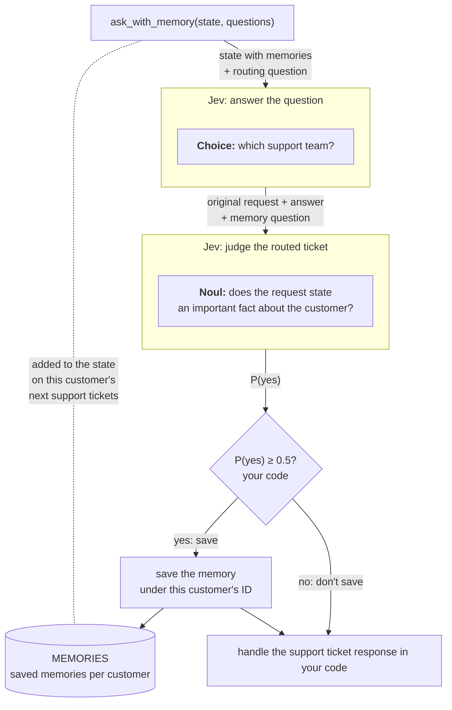

<!-- Source: https://docs.typesafe.ai/cookbooks/basic_memory | Fetched: 2026-10-19 via Firecrawl (llms-full.txt) -->

# Simple memory system

Let Jev decide which requests and answers are worth remembering, then wrap the Jev call in a small function that adds memories to later calls.

Each Jev request sees only the state you send it. What a customer told your app last
month, such as their edition or their plan, is not in their next request unless your code
puts it there. The memory system here does that with one extra Jev request per call and a
Python dict.

Our example routes support tickets. In August, a customer said they self-host on Windows
Server. In September they write "Dashboards have been really slow since this morning".
Without memory, Jev sends that ticket to the cloud team instead of the self-hosted team.
In the example below, adding memory sends all six later tickets to the expected teams.
Routing each ticket alone gets two out of six correct.

The simple memory system has two parts:

* After each call, Jev sees the original request and its answer together. A
  `Noul` question, which we call the gate, asks whether the request states an important
  fact about the customer that should be remembered. If P(yes) is at least 0.5, the
  ticket and Jev's answer are saved as a memory for that customer.
* A wrapper function, `ask_with_memory()`, takes the same `state` and `questions`
  arguments as `ask()`, which is the TypeSafe Python SDK `client.system_one` method with
  the model pinned and the call cached, and returns the Jev response. Before each call, it
  adds the customer's saved tickets and Jev's answers to them to the state.

That wrapper is a basic agent harness. A harness is the code around a model that
gives it extra capabilities such as tool calls and running in loops. This basic toy one
only gives it memory in a plain Python dict with one list per customer ID.



The wrapper makes two Jev requests, one after the other: the routing request, then the
gate, which judges the ticket together with Jev's answer. The wrapper returns the routing
response whether or not anything is saved.

Because `ask_with_memory()` takes the same arguments as `ask()` and returns the same
response, you can swap one for the other without changing any other code. The wrapper
finds the customer's memories, adds them to the state and saves new ones itself.

The example sends five earlier tickets from two customers through the wrapper, then routes
three later messages from each customer twice: once with the memories it saved, once
without. A table puts the two answers side by side for all six.

## Setup

```bash theme={null}
pip install ipython 'cooksafe>=0.2.0,<0.3.0'
```

Set `TYPESAFE_API_KEY`. Every API call is cached in
[`json_cache.json`](https://github.com/typesafe-ai/typesafe-public-examples/blob/main/cookbooks/basic_memory/json_cache.json).
Download it into the folder you run this code from to replay the published numbers
instead of calling the API, or leave it out to run everything live.

Numbers below came from `jev-1.13.0` on 2026-09-28.
The memory threshold of 0.5 is a starting point. You should evaluate it against
your own examples.

```python theme={null}
import json
import os
from pathlib import Path

from cooksafe import JsonCache, make_playground_link
from IPython.display import Markdown, display
from typesafe_sdk import Choice, Noul, NoulCriteria, SystemOneResponse, TypeSafeClient

TYPESAFE_MODEL = "jev-1.13.0"
REMEMBER_AT = 0.5  # save when P(lasting customer fact) reaches this starting threshold
MEMORY_KEY = "earlier_tickets_from_this_customer"  # where saved tickets go in the state

client = TypeSafeClient(
    api_key=os.environ.get("TYPESAFE_API_KEY", "cache-only"),  # keyless kernels replay the cache
    base_url=os.environ.get("TYPESAFE_ENDPOINT"),
    timeout=120.0,
)
json_cache = JsonCache(Path("json_cache.json"))
```

## Define the tickets

Two customers, five earlier tickets and three later messages, all written for this
cookbook. C-1042 (Harbor Logistics) runs the self-hosted edition on Windows Server under an
Enterprise contract. C-2210 (Fernwood Studio) is on the cloud edition's self-serve Team
plan. Three of the earlier tickets state a lasting fact: an edition, a plan, a contract.
Two don't: a phone at the airport, a public holiday. No later message mentions the
customer's setup, so without memory Jev has to guess it.

Each ticket becomes a state with two parts: `customer`, who the customer is, and
`ticket`, the ticket thread. The `ticket_state()` function builds a
simplified ticket, like one from a helpdesk. In your app, the state is each ticket as
your helpdesk sends it, and `ask_with_memory()` adds the customer's saved tickets to it.
The split into earlier tickets and later messages is only for this example.

```python expandable theme={null}
DATA = {
    "customers": {
        "C-1042": {"id": "C-1042", "company": "Harbor Logistics"},
        "C-2210": {"id": "C-2210", "company": "Fernwood Studio"},
    },
    "earlier_tickets": [
        {"id": "T-101", "customer_id": "C-1042", "received_on": "2026-08-04",
         "subject": "Adding an admin",
         "text": "Hi, we run your self-hosted edition on Windows Server 2022 in our own data "
                 "centre. How do I add a new admin user?"},
        {"id": "T-102", "customer_id": "C-2210", "received_on": "2026-08-11",
         "subject": "Exporting to PDF",
         "text": "We're a small design studio on your cloud edition, paying monthly on the "
                 "self-serve Team plan. How do I export a dashboard as a PDF?"},
        {"id": "T-103", "customer_id": "C-1042", "received_on": "2026-08-19",
         "subject": "Invoice download",
         "text": "Sorry for the typos, typing this on my phone at the airport. Where can I "
                 "download last month's invoice?"},
        {"id": "T-104", "customer_id": "C-2210", "received_on": "2026-09-02",
         "subject": "Dark mode?",
         "text": "Our whole team is out on Friday for a public holiday, so no rush on this "
                 "one. Is there a dark mode?"},
        {"id": "T-105", "customer_id": "C-1042", "received_on": "2026-09-10",
         "subject": "Sandbox environment",
         "text": "For context, we signed an Enterprise contract with you in March. Can we get "
                 "a sandbox environment for testing?"},
    ],
    "later_messages": [
        {"subject": "Slow dashboards",
         "text": "Dashboards have been really slow since this morning."},
        {"subject": "Upgrade failing",
         "text": "The upgrade to version 5.2 keeps failing halfway through."},
        {"subject": "More seats",
         "text": "We'd like to add 20 more seats before next quarter."},
    ],
    "later_received_on": "2026-09-28",
    # Labelled by hand from what each customer said in the earlier tickets.
    "expected_team": {
        "C-1042": {"Slow dashboards": "selfhosted_windows",
                   "Upgrade failing": "selfhosted_windows", "More seats": "enterprise_desk"},
        "C-2210": {"Slow dashboards": "cloud_ops", "Upgrade failing": "cloud_ops",
                   "More seats": "billing"},
    },
}
CUSTOMERS = DATA["customers"]


def ticket_state(customer_id: str, ticket_id: str, received_on: str, subject: str,
                 text: str) -> dict:
    """The state Jev sees for one ticket: a simplified ticket, like one from a helpdesk."""
    return {
        "customer": CUSTOMERS[customer_id],
        "ticket": {
            "id": ticket_id,
            "received_on": received_on,
            "subject": subject,
            "messages": [{"from": "customer", "text": text}],
        },
    }


EARLIER = [
    ticket_state(t["customer_id"], t["id"], t["received_on"], t["subject"], t["text"])
    for t in DATA["earlier_tickets"]
]
print(f"{len(CUSTOMERS)} customers, {len(EARLIER)} earlier tickets, "
      f"{len(DATA['later_messages'])} later messages. The first ticket as Jev sees it:\n")
print(json.dumps(EARLIER[0], indent=2))
```

```
2 customers, 5 earlier tickets, 3 later messages. The first ticket as Jev sees it:

{
  "customer": {
    "id": "C-1042",
    "company": "Harbor Logistics"
  },
  "ticket": {
    "id": "T-101",
    "received_on": "2026-08-04",
    "subject": "Adding an admin",
    "messages": [
      {
        "from": "customer",
        "text": "Hi, we run your self-hosted edition on Windows Server 2022 in our own data centre. How do I add a new admin user?"
      }
    ]
  }
}
```

## Route a ticket

One `Choice` question picks the support team. The `none_suitable` option gives Jev an
answer for when no team fits, and a ticket with too little context can end up there.

The helper `ask()` is `client.system_one` with the model version fixed and every call
cached. It takes a state and a dict of questions and returns the SDK's own response
object, so code that already reads `client.system_one` responses works with it unchanged.

```python expandable theme={null}
ROUTE = {
    "team": Choice(
        instructions="Which support team should handle `ticket`?",
        criteria={
            "cloud_ops": "Cloud team: problems with the hosted cloud edition, run by us",
            "selfhosted_linux": "Self-hosted team, Linux: installs, upgrades and "
            "performance of the self-hosted edition on Linux servers",
            "selfhosted_windows": "Self-hosted team, Windows: installs, upgrades and "
            "performance of the self-hosted edition on Windows Server",
            "billing": "Billing: invoices, payments, seats and plan changes for "
            "self-serve plans",
            "enterprise_desk": "Enterprise desk: seats, contracts and account changes for "
            "customers on an Enterprise contract (their technical problems go to the "
            "technical teams)",
            "general": "General product questions: features, how-to, settings",
            "none_suitable": "None of these teams fits the ticket",
        },
    ),
}


@json_cache
def _system_one(model: str, state: str, questions: str) -> dict:
    response = client.system_one(
        state=json.loads(state), questions=json.loads(questions), model=model
    )
    return response.model_dump(mode="json")


def ask(state: dict, questions: dict) -> SystemOneResponse:
    """client.system_one, with the model pinned and the call cached."""
    as_json = {qid: q.model_dump(mode="json", exclude_none=True) for qid, q in questions.items()}
    raw = _system_one(TYPESAFE_MODEL, json.dumps(state), json.dumps(as_json))
    return SystemOneResponse.model_validate(raw)


def later_state(customer_id: str, message_index: int) -> dict:
    """One of the later messages, sent by this customer, with a fixed ticket ID."""
    n = 201 + 3 * list(CUSTOMERS).index(customer_id) + message_index
    message = DATA["later_messages"][message_index]
    return ticket_state(customer_id, f"T-{n}", DATA["later_received_on"], message["subject"],
                        message["text"])


slow = later_state("C-1042", 0)
team = ask(slow, ROUTE).answers["team"]
print(f"C-1042: {slow['ticket']['messages'][0]['text']!r}")
print(f"  plain Jev -> {team.choice} {team.probabilities[team.choice]:.2f}")
```

```
C-1042: 'Dashboards have been really slow since this morning.'
  plain Jev -> cloud_ops 0.80
```

Plain Jev sends C-1042's slow dashboards to the cloud team. This ticket alone gives it no
reason to do anything else.

## Ask Jev whether the ticket is worth remembering

First, `as_memory()` pairs the original state with Jev's answer: the memory the wrapper
may save. The `request` key
holds the state before memories were injected, and `jev_answered` maps each question
to its answer. This keeps old memories from being nested inside every new memory.

A second Jev call reads that pair. The gate asks whether the request
states an important fact about the customer, such as their edition, operating system, plan
or contract. Jev's answer is there as context, but a fact that appears only in the
answer does not count. Without that rule, a generic answer such as "General product
questions" can outweigh a real fact in the request, and an answer that relied on an
earlier memory can be saved again as if it were new.

```python expandable theme={null}
GATE = {
    "remember": Noul(
        instructions=(
            "In `request.ticket`, does the thread state a lasting fact about the customer that "
            "should change how their future, unrelated tickets are handled? Count what the "
            "customer or our support staff wrote in `request.ticket`. `jev_answered` shows how "
            "the ticket was routed, which may rely on things learned earlier: do not count "
            "anything it says or implies."
        ),
        criteria=NoulCriteria(
            true=(
                "Yes: in `request.ticket` the customer or our support staff state something "
                "about the customer that stays true after this ticket, such as the product "
                "edition or operating system they run, their plan or contract, or a standing "
                "preference."
            ),
            false=(
                "No: `request.ticket` only contains things specific to this one ticket or "
                "moment, such as a one-off request, today's schedule, or the device they "
                "happen to be typing on; or the lasting fact appears only in `jev_answered`."
            ),
        ),
    ),
}


def answer_text(question, answer):
    """The readable part of an answer: the chosen option's description, or the number."""
    if answer.type == "choice":
        return question.criteria[answer.choice]
    return answer.noul if answer.type == "noul" else answer.score


def as_memory(state: dict, questions: dict, response: SystemOneResponse) -> dict:
    return {
        "request": state,
        "jev_answered": {
            q.instructions: answer_text(q, response.answers[qid])
            for qid, q in questions.items()
        },
    }


def remember_probability(memory: dict) -> float:
    """P(the request states an important fact about the customer), with the answer as context."""
    return ask(memory, GATE).answers["remember"].noul
```

## Wrap the call so it remembers

The wrapper, `ask_with_memory()`, has the same arguments and return value as `ask()`. The
memory store is a plain dict with one list per customer ID. The wrapper uses the ID in
the state to select the customer's memories.

```python theme={null}
MEMORIES: dict[str, list[dict]] = {}  # customer ID -> that customer's saved memories


def customer_id(state: dict) -> str:
    return state["customer"]["id"]


def ask_with_memory(state: dict, questions: dict) -> SystemOneResponse:
    """ask(), plus memory: same arguments, same return value."""
    # 1. Answer the call with this customer's existing memories.
    saved = MEMORIES.get(customer_id(state), [])
    response = ask({**state, MEMORY_KEY: saved} if saved else state, questions)

    # 2. Ask Jev whether the original request states an important fact worth keeping.
    memory = as_memory(state, questions, response)
    if remember_probability(memory) >= REMEMBER_AT:
        MEMORIES.setdefault(customer_id(state), []).append(memory)
    return response
```

Adding memory this way has four consequences for your app:

* **Every call makes two sequential requests**, your call followed by the memory gate.
  The gate judges the ticket together with Jev's answer, so it runs after the routing
  request. If your gate ignores the answer, it could instead be a second question in the
  routing request (see [fan-out](/patterns/fan-out)).
* **Memory only grows.** Every saved memory goes into every later call for that
  customer. There is no size limit, no check for relevance and no expiry date here. The
  Next steps section has ideas for each.
* **Your questions never mention the memories.** The memories go into the state under
  `earlier_tickets_from_this_customer`, and Jev reads the whole state. Nothing in
  `ROUTE` changes.
* **The state needs `customer.id`.** Plain Jev also accepts a string as the state, but
  this wrapper needs the ID to find the customer's list.

## Send the earlier tickets and watch the answers change

Send the five earlier tickets through `ask_with_memory()`, in the order they arrived. The
same customer sends two of the later messages again: slow dashboards and 20 more seats.
That shows how each saved memory changes Jev's answers. The repeated messages go through
the wrapper too, so the gate judges them as well.

```python theme={null}
PROBES = {"Slow dashboards": 0, "More seats": 2}  # later messages to send after each ticket


def memory_ids(cid: str) -> str:
    return ", ".join(m["request"]["ticket"]["id"] for m in MEMORIES.get(cid, [])) or "none"


def send_probes(cid: str) -> None:
    for subject, i in PROBES.items():
        team = ask_with_memory(later_state(cid, i), ROUTE).answers["team"]
        print(f"      {subject:<16} -> {team.choice:<19} {team.probabilities[team.choice]:.2f}")


for cid in CUSTOMERS:
    print(f"{cid}, memories: {memory_ids(cid)}")
    send_probes(cid)

for state in EARLIER:
    cid = customer_id(state)
    response = ask_with_memory(state, ROUTE)
    p = remember_probability(as_memory(state, ROUTE, response))  # cached: the wrapper's call
    verdict = "saved" if p >= REMEMBER_AT else "not saved"
    text = state["ticket"]["messages"][0]["text"]
    print(f"\n{cid} {state['ticket']['id']}  {response.answers['team'].choice:<19} "
          f"P(remember) {p:.2f}  {verdict}")
    print(f"    {text[:84]}")
    print(f"{cid}, memories: {memory_ids(cid)}")
    send_probes(cid)
```

```text expandable theme={null}
C-1042, memories: none
      Slow dashboards  -> cloud_ops           0.80
      More seats       -> enterprise_desk     0.62
C-2210, memories: none
      Slow dashboards  -> cloud_ops           0.75
      More seats       -> enterprise_desk     0.52

C-1042 T-101  selfhosted_windows  P(remember) 0.91  saved
    Hi, we run your self-hosted edition on Windows Server 2022 in our own data centre. H
C-1042, memories: T-101
      Slow dashboards  -> selfhosted_windows  0.99
      More seats       -> enterprise_desk     0.44

C-2210 T-102  general             P(remember) 0.91  saved
    We're a small design studio on your cloud edition, paying monthly on the self-serve 
C-2210, memories: T-102
      Slow dashboards  -> cloud_ops           0.91
      More seats       -> billing             0.98

C-1042 T-103  billing             P(remember) 0.07  not saved
    Sorry for the typos, typing this on my phone at the airport. Where can I download la
C-1042, memories: T-101
      Slow dashboards  -> selfhosted_windows  0.99
      More seats       -> enterprise_desk     0.44

C-2210 T-104  general             P(remember) 0.10  not saved
    Our whole team is out on Friday for a public holiday, so no rush on this one. Is the
C-2210, memories: T-102
      Slow dashboards  -> cloud_ops           0.91
      More seats       -> billing             0.98

C-1042 T-105  enterprise_desk     P(remember) 0.92  saved
    For context, we signed an Enterprise contract with you in March. Can we get a sandbo
C-1042, memories: T-101, T-105
      Slow dashboards  -> selfhosted_windows  0.94
      More seats       -> enterprise_desk     0.99
```

The three tickets that state an edition, a plan or a contract are saved at 0.91 to 0.92.
T-102 is saved even though Jev routed it to the general team, because the gate counts
the customer's words, not the answer. The airport and public-holiday tickets score 0.07
and 0.10 and are not saved, so the answers after them do not change.

Each saved memory changes the answers it is relevant to. For C-1042, the Windows ticket
moves slow dashboards from the cloud team (0.80) to the Windows team (0.99). The Enterprise
contract then settles seats at 0.99. For C-2210, the Team-plan ticket raises the cloud team
from 0.75 to 0.91 and moves seats from the Enterprise desk (0.52) to billing (0.98). Adding
the Enterprise memory lowers C-1042's slow dashboards slightly, from 0.99 to 0.94, which is
one reason to choose which memories to add (see Next steps). The gate saved none of the
repeated messages.

## Route the same messages for both customers

Each customer now sends the three later messages. Each message goes to plain `ask()` and
to `ask_with_memory()`, with the same state and the same question.

```python theme={null}
EXPECTED = DATA["expected_team"]
plain_correct = memory_correct = total = 0
example_state = None


def cell(answer, expected: str) -> str:
    mark = "✓" if answer.choice == expected else "✗"
    return f"{mark} {answer.choice} {answer.probabilities[answer.choice]:.2f}"


print(f"{'customer':<9}{'message':<17}{'expected':<20}{'plain Jev':<27}{'with memory':<27}")
for cid in CUSTOMERS:
    for i, message in enumerate(DATA["later_messages"]):
        state = later_state(cid, i)
        expected = EXPECTED[cid][message["subject"]]
        plain = ask(state, ROUTE).answers["team"]
        if example_state is None:
            # Keep the exact state used for this call for the playground link.
            saved = MEMORIES.get(cid, [])
            example_state = json.loads(json.dumps({**state, MEMORY_KEY: saved} if saved else state))
        response = ask_with_memory(state, ROUTE)
        remembered = response.answers["team"]
        plain_correct += plain.choice == expected
        memory_correct += remembered.choice == expected
        total += 1
        print(f"{cid:<9}{message['subject']:<17}{expected:<20}{cell(plain, expected):<27}"
              f"{cell(remembered, expected):<27}")

print(f"\nExpected routes: {plain_correct}/{total} without memory, "
      f"{memory_correct}/{total} with memory.")
```

```
customer message          expected            plain Jev                  with memory                
C-1042   Slow dashboards  selfhosted_windows  ✗ cloud_ops 0.80           ✓ selfhosted_windows 0.94  
C-1042   Upgrade failing  selfhosted_windows  ✗ none_suitable 0.60       ✓ selfhosted_windows 1.00  
C-1042   More seats       enterprise_desk     ✓ enterprise_desk 0.62     ✓ enterprise_desk 0.99     
C-2210   Slow dashboards  cloud_ops           ✓ cloud_ops 0.75           ✓ cloud_ops 0.91           
C-2210   Upgrade failing  cloud_ops           ✗ none_suitable 0.63       ✓ cloud_ops 0.86           
C-2210   More seats       billing             ✗ enterprise_desk 0.52     ✓ billing 0.98             

Expected routes: 2/6 without memory, 6/6 with memory.
```

With memory, all six messages reach the expected team, against two without. The same
message now goes to a different team for each customer: slow dashboards go to the
Windows team for C-1042 and stay with the cloud team for C-2210, and 20 more seats go to
the Enterprise desk for C-1042 and to billing for C-2210. Where plain Jev was already
right, memory raises the probability, from 0.62 to 0.99 for C-1042's seats. The wrapper
also judged the six later messages, and saved none: they state no important fact.

Each row's expected team follows from the customer's setup in the earlier tickets:
C-1042's self-hosted edition and Enterprise contract, C-2210's cloud Team plan.

## Open it in the playground

The link holds the exact routing state used for C-1042's first slow-dashboards call,
including its memories at that point, plus the routing question.

```python theme={null}
playground_link = make_playground_link(example_state, ROUTE, models=[TYPESAFE_MODEL])
display(Markdown(
    f"🔗 [Open C-1042's ticket with its memories in the TypeSafe playground]({playground_link})"
))
```

<a href="https://console.typesafe.ai/playground#share/N4IgJg9gxgrgtgUwHYBcAqCAeKQC4AEIwAOiLAM4oSIBOpBJIAlmPfqQMIC0AjAAwAWAEykANOzLUADgEMkATzakAEjJoAjCDXwAZCAHMmlJlHKkAvuNIoTAawQo2jFkpBouQvjzESaCKAhMAG4IYAD6EEiunkIAbFx8AJweABw+pOQw6gBW-o54EgDKADYQAO74YDLkABaaamBmIFYgiOTkMvoITQQA2owAZjTUrhRUtOkgKFj5BKQAItV1EA3k+DUyIfjqCMj4fjLFxfL45KUV5ExIAfgoNUb4cFpIV-oAdBYAupYSCGrFTAQNDCNig9hQ5DCQ2oIPukLG1CBbH6pD8AEcYN1ZvhGAiJgVnKwCpxeIIRM0JFBpHJFMSQKoNFpdAYjKCmj9rHYHE5SC46e5+N4Kaj-IEQuFItE+HEEikEgJJpkcnlXABBMBgV74OTasBwK6TNodLo9fAokDQuCjGCURF0YVTGauZRMcRlBD7GBIfDyCAwbTkBDFAZcGoQSihfChJg2SL4OMAdSukDKa0KQJC2hiQnwV3j-vjZW9VRQMnwAVQfje+GU5UqEHwAEldWBtfgkAgKjI9XmbUCAPxfcwckC5IJhOTkd1+IkMUgJ+5QGqnGBSKRaFC3P5wU5hmDFVsbJBgYoegAGoPBZ8HdPTwdD4emremMjg4iTx-K5AIV0oh2K5DiKu+g0N23Tase+BSECAxaHAcg3BAAy3DUHqBveYYRq20axt6ibJl++DpjQmYWD8jDopilA8mQNrjEiBK8rOEjcPwwiTFScCyAozpqJo2h6IYximBYLSXtyjHMMxpACnwACskx+AEwShBEUR0jE8RJKSipZLkUDYqQhRyGAmiYFGSBBEwwxIIgqCGt0xrdMigzDFadJ4gxYlOnSABiTJUqgMxumhTD6B2rY6gAokFNBSDQRgeoFKCgQZ+BlDGy6+jAubegAsmoS7VhwOruvgXSbmWHTHmZFlWTZdmbrB2jTMYSD6De5jfCOY4TkgU5AqENELiYy6ZGuG5bq+u5+ge6wmae+AXlyKDXq4MXTHFCWBpU3S2AQgYyBC4jJalEIQZFUBUl6m5LnIJr4M15Z0XaaxxtFsXxYl5aRClMhpQAFHcgQtf4NQvFAhxQcM6innAaz6A2VAoR60xLhDUMvvDACUZHfBSIDxdIEIYNgBRENY240Sg8jQaMYYmAgky-ilMAGUwkSmvOi5jau640JuWMzfuh4Lee4mrTeLRQAlm1MDINFQKUMASlIXMgBwyvPtuBBE7DCDw+lmUo+sj6RkrfrYZquHiDQXrbCcNqKkGAyYU+YQAkgMCYK4d4hm7kZY+IOhXN7P79aWRyAfgwGgWA4EmVBMFwQhHpISb6H+2bVsxhzeHeiHXvmYGJFAk0LSZwH4QZZ+qa+y7D5YVNb74B+Kbfrlf5R0BUggWBayJ9BNDNfB1xp8hwOnA3VdRtbefxt6beEcRpEOuoTBHK8rgAEIb57+jh0EECM9HsjyI10eHedg-FDqd3teBT2Z1wJdbFIt-9ZMyCbV9gZhPH5BbDrU+ttD0AD9pTyOtHU6-1r6QX+tdVA5YjwPSep5Ggb1vQfR-qAn6lZYH4CBqhayW50YmChnrOGCMkZI1QqQ8G5DijN3ILjB0XQOygWKK4AA4sgIEFDhhgDZpuDEWI84dwGH8FA-pujiDDGULgVBxCBhQDYdq5cJBIEiAgMImQYwyH1q4AActo+ME9UI7SxmsAYMY1iTwlmRcwBMZBSCYAANTLnncmQQeAE3QnkUIeUIDxwAgUXoo4EBBF4G8HgABmN4fAQDfCAA">Open C-1042's ticket with its memories in the TypeSafe playground →</a>

## Next steps

* **Choose what your app should remember.** Edit `GATE` to describe what is worth
  remembering for your own task, and test `REMEMBER_AT` against examples you have labelled.
* **Choose which memories to add.** The wrapper adds every saved memory. A relevance
  question can select a smaller set once the list gets long.
* **Replace outdated memories.** Ask whether a new memory replaces an older one, then
  remove the old entry in code when appropriate.
* **Keep memories between runs.** Replace `MEMORIES` with a database keyed by customer
  ID. The in-memory dict disappears when the process exits.
* **Act on the route.** Map each team to a handler in code, such as booking a call for
  Enterprise customers or sending a setup-specific article. See
  [intent routing](/patterns/intent-routing) and
  [confidence-based routing](/patterns/confidence-routing). Add your reply to the ticket
  thread as a support message, and the gate can remember what you did.

***

# Appendix

## Can a saved answer reinforce a mistake?

Yes. The gate ignores anything that appears only in Jev's answer, so an answer can't get a
ticket saved by itself. Once a ticket is saved, though, its answer is saved with it,
mistaken inference and all, and every later call for that customer reads it. A later
answer can then repeat the mistake.

## How should I choose the threshold?

The 0.5 in this wrapper is a starting value. To pick your own, label request-and-answer
pairs from your traffic as worth remembering or not, and find the probability that best
separates the two groups. Check it on pairs you didn't use to pick it. Raise it if a
misleading memory costs more than a missing one; lower it if the reverse. See
[Confidence](/confidence) and [Confidence-Gated Routing](/patterns/confidence-routing) for
choosing thresholds and matching them to the risk of each action.
